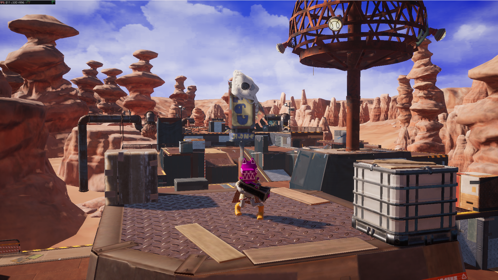

# 引擎优化入门

<tldr>

Unreal Engine Vite 是 Unreal Engine 4.27 的性能优先分支，构建于 NvRTX 与 Plus 分支之上。
它保留 PhysX，并加入 DDGI、RTXDI、曲面细分、SMAA 与 HBAO+，
面向主机级硬件，追求原生分辨率下的高帧率。

初次接触？请先读[Vite 简介](./GettingStarted/Introduction-to-Vite.md)，然后
[从源码构建引擎](./GettingStarted/Build-From-Source.md)。

</tldr>

---

欢迎阅读 Unreal Engine Vite 手册。本站记录的是这个引擎分支本身：如何构建它、相对原版 Unreal Engine 4.27 改了什么、新增了哪些渲染与物理系统，以及如何在其上交付项目。

Vite 面向正在量产中的团队，而不是研究分支或技术演示。本手册记录的每项功能，都以能在真实硬件上完成烘焙、打包与交付为前提；全书的写法也基于这一前提。

*完全由动态光线追踪全局光照点亮的风格化演示：在 RTX 4080 Super 上以 1440p 原生分辨率测得 811 FPS。同一场景在 Unreal Engine 5.7 的 Lumen 上测得 324 FPS。*

## Vite 的目的是什么

Unreal Engine 5.7 与 5.8 的目标是：在 PlayStation 5 上借助 Lumen、Nanite、虚拟阴影贴图（Virtual Shadow Maps）、TSR 与 Chaos，以 720p–1080p 的动态内部分辨率跑到大约 60 FPS。这套技术栈依靠虚拟化与时间重建换取画面保真度，代价是处理、流送与内存开销，以及噪点、重影与模糊；此外，即使项目尚未搭建任何内容，渲染器本身的基础成本也很高。

随着 Nintendo Switch 2 上市、Steam Deck 这类掌机站稳脚跟、硬件成本上涨，这种取舍越来越难以装进游戏实际运行的硬件里。Vite 押的是相反的方向：保持高视觉保真度，严格控制帧时间，并以原生分辨率渲染。

具体来说，相对 UE 5.7 的目标功能集，实际游戏帧率最高可达 2.5 倍；这有实测数据支撑，而非断言——参见[UE4 与 UE5 成本分析](./EngineOverview/UE4-Versus-UE5-Cost-Analysis.md)与[项目与演示](./ProjectsAndDemos.md)。

## 从哪里开始

选择与你现在要做的事最接近的入口。

| 我想要&nbsp;&hellip; | 从这里开始 |
|---|---|
| 了解 Vite 是什么、是否适合我的项目 | [Vite 简介](./GettingStarted/Introduction-to-Vite.md) |
| 让引擎在我的机器上跑起来 | [入门](./GettingStarted/Getting-Started.md) |
| 从源码编译引擎 | [从源码构建](./GettingStarted/Build-From-Source.md) |
| 修复编译或环境配置错误 | [构建故障排除](./GettingStarted/Build-Troubleshooting.md) |
| 把现有 UE5 项目迁移到 Vite 上 | [从 UE5 迁移](./GettingStarted/Migrating-From-UE5.md) |
| 在没有 Lumen 的情况下照亮场景 | [全局光照](./Rendering/Global-Illumination.md) |
| 在游戏代码中用 PhysX 替换 Chaos | [PhysX](./Physics/PhysX.md) |
| 查找控制台变量 | [控制台变量](./Reference/Console-Variables.md) |
| 为 fork 做贡献 | [贡献](./Contributing/Contributing.md) |

## Vite 所围绕的功能

* 动态 DDGI

    光线追踪辐照度探针体积。结构上没有噪点、完全动态，在可比场景中帧率约为硬件 Lumen 的两倍。参见[动态 DDGI](./Rendering/DDGI-Dynamic.md)。

* 静态 DDGI

    沿用同一套探针表示，烘焙近乎瞬时完成。相比传统烘焙光照，反射保真度更高、对动态物体的覆盖更广，而且在完全不支持光线追踪的 GPU 上也能运行。参见[静态 DDGI](./Rendering/DDGI-Static.md)。

* 优化的 RT 反射

    在 PS5 级 GPU 上可实现 4K 原生 60 帧。开启 DDGI 后，反射光线在二次弹射时会采样探针辐照度，而不是返回黑色。参见[光线追踪反射](./Rendering/RT-Reflections.md)。

* UE4 时代的 SSGI

    UE5 把 SSGI 并入 Lumen 时，其质量与性能都有所下降，并且无法再与独立的全局光照方案并行使用。在 Vite 中，它可以无附加条件地与 DDGI 并存。参见[SSGI](./Rendering/SSGI.md)。

* PhysX 3.4

    针对新版 Clang 重建了库，新增 Blast 支持，并支持跨平台 GPU 加速粒子。在相同工作负载下明显快于 Chaos。参见[PhysX](./Physics/PhysX.md)。

* Apex 破坏与布料

    两者在 UE5 中均已弃用并移除，且现有资产没有迁移路径。在 Vite 中它们仍然可用。参见[破坏与布料](./Physics/Destruction-And-Cloth.md)。

* RTXDI

    与 5.1 及以后版本中 Lumen 内置的 MegaLights 相比，[RTXDI](./Rendering/RTXDI.md) 是噪点更少的一种替代方案。

* 曲面细分（Tessellation）

    基于距离与位移的几何细节：更平滑的表面、更干净的轮廓，以及运行期的高频细节，且没有 Nanite 的额外开销。参见[曲面细分](./Rendering/Tessellation.md)。

## 性能目标

以下每个目标都包含光线追踪。完整细节与测量条件见[性能目标](./EngineOverview/Performance-Targets.md)。

| PS5 级目标 | 包含内容 |
|---|---|
| **风格化，4K 120 FPS** | 光线追踪 DDGI，如风格化演示所示。面向竞技多人游戏。 |
| **性能／高端，4K 60 FPS** | DDGI、RT 反射与曲面细分，如 Unreal Tournament Vite 演示所示。 |
| **保真／高端，4K 30 FPS** | 同一套技术栈，面向几何密度很高的大型开放世界。 |
| **保真／全 RT，1440p 30 FPS** | 在 DDGI 与 RT 反射之上，再加 RTAO 与 RT 阴影。 |

## 手册部分

* 入门

    安装、工具链配置、从源码构建、创建第一个项目，以及把现有 UE5 项目迁移过来。参见[入门指南](./GettingStarted/Getting-Started.md)。

* 引擎概述

    这个分支为什么以 NvRTX 4.27 为基础、它的设计目标是什么，以及 UE4 与 UE5 之间可量化的成本差距来自哪里。参见[引擎概述](./EngineOverview/Engine-Overview.md)。

* 渲染

    全局光照、光线追踪、着色模型、抗锯齿、超分辨率、曲面细分、环境光遮蔽与色彩管理。这是手册中篇幅最长的部分，也是 Vite 与原版 4.27 差异最大的地方。参见[渲染](./Rendering/Rendering.md)部分。

* 物理

    PhysX 3.4 作为产品交付时的物理后端：快速路径、固定时间步长、Apex 破坏、Apex 布料、爆炸，以及大规模实例化刚体。参见[物理](./Physics/Physics.md)部分。

* 性能与优化

    分析工具、引擎默认设置、Vite 开箱即用的改动、着色器编译与 PSO 行为、可伸缩性，以及如何精简引擎以加快迭代。参见[性能与优化](./Performance/Performance.md)部分。

* 平台

    各目标平台支持哪些功能、有哪些渲染器路径可用，以及 Vite 针对什么硬件做了优化。参见[平台](./Platforms/Platforms.md)部分。

* 插件

    引擎自带的插件，以及新插件的审核流程。参见[插件](./Plugins/Plugins.md)部分。

* 工具和自动化

    ViteSetup.bat 助手负责安装引擎构建、打包与分发脚本，以及缓存管理。参见[工具和自动化](./Tools/Tools.md)部分。

* 项目和演示

    可下载的示例项目与基准测试场景，以及它们所用的硬件参数。参见[项目和演示](./ProjectsAndDemos.md)。

* 贡献

    编码规范、提交与拉取请求约定，以及把 UE5 改动回移到分支的向后移植流程。参见[贡献](./Contributing/Contributing.md)部分。

* 参考

    控制台变量参考、编译时开关、术语表与常见问题。参见[参考文档](./Reference/Reference.md)。

## 社区和项目链接

| 资源 | 链接 |
|---|---|
| 引擎仓库 | [ViteStudio-Tech](https://github.com/ViteStudio-Tech) |
| 社区 Discord | [discord.gg/n9zQrYFhMb](https://discord.gg/n9zQrYFhMb) |
| 工作计划（Trello） | [UE Vite PhysX Studio 分支](https://trello.com/b/JKyBFS5X/ue-vite-physx-vite-studio-fork) |
| 公共资源 | [Google Drive](https://drive.google.com/drive/folders/16FOkb5u6GSqHiWeAm50NaxZ19QFBwZeI?usp=sharing) |
| 支持开发 | [ko-fi.com/vitestudio](https://ko-fi.com/vitestudio) |
| 媒体更新 | [@theredpix](https://x.com/theredpix) |

> Vite 由一个精干的引擎程序员团队开源开发。如果你想参与代码贡献，请阅读[贡献指南](./Contributing/Contributing.md)，并在 Discord 上申请 Forker 角色。
