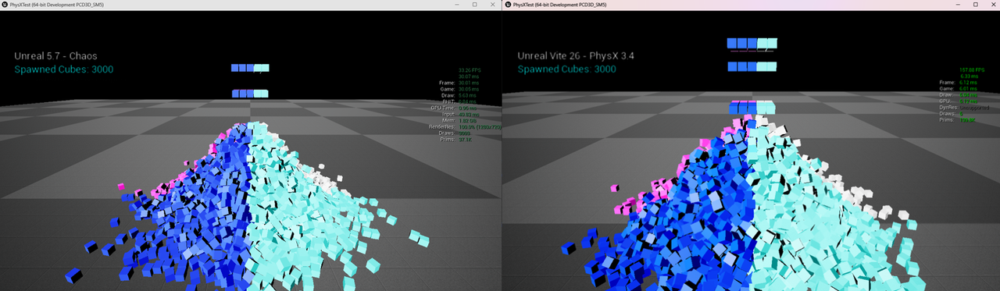

# UE4 与 UE5 的成本分析

!!! note "概要"
    性能差距并不来自某一个系统，而是着色器指令数、物理、角色移动、内存、Slate、骨骼网格体、Tick 成本、渲染线程结构、蓝图原生化能力缺失与体积着色器各自独立叠加的结果。

性能差距并非源于单一系统。它是由着色器指令数、物理引擎、角色移动、内存、Slate、骨骼网格体、Tick 开销、渲染线程结构、蓝图原生化功能的缺失以及体积着色器等诸多因素共同造成的——每个因素都独立地影响着性能。

本页面记录了虚幻引擎 4.27 和现代 UE5 之间实际性能差异的来源。之所以要记录，是因为仅仅说「UE5 更慢」并不能指导行动；只有了解是**哪个**子系统退步、退步多少，才能决定一个分支是否值得维护。

相关测量数据收集在一个[公开电子表格](https://docs.google.com/spreadsheets/d/1TabQV7UTDLMHI9GVFCbMzXohax2Agm2qzET7tOOXN7w/edit?usp=sharing)中。

## 材质和着色器

从虚幻引擎 5.1 开始，着色器模型 6 (Shader Model 6) 成为首选渲染路径，SM5 和 SM6 路径的着色器指令总数均显著增加。后续版本进一步扩展了指令总数和排列组合数。

虚幻引擎 4.27 生成了更轻量级的着色器，在保证相同视觉效果的前提下，直接换来整体更低的 GPU 耗时——而不仅仅是在使用新特性的场景中。

## 物理模拟

在许多工作负载下，Chaos 的速度明显慢于 PhysX，这主要是由于其 SIMD（Single Instruction, Multiple Data，单指令多数据流）利用率较低、多线程性能相对较差以及整体工程决策效率较低所致。

内部压力测试表明，在物理密集型场景下，Chaos 的性能比 PhysX 慢 5 倍以上。这种差距不仅限于刚体模拟：它还会影响物理查询、碰撞计算和变换传播，这意味着即使项目很少或根本不显式使用物理模拟，仍然会付出可观的 CPU 成本。

*模拟 3000 个立方体。Unreal 5.7 搭配 Chaos（左图）为 33.26 FPS，帧时间 30.07 ms；Vite 搭配 PhysX 3.4（右图）为 157.88 FPS，帧时间 6.33 ms——交付帧率相差 4.7 倍。*

实际后果体现在规模上。同样的 CPU 预算在 PhysX 下能换来复杂得多的布料模拟与破坏效果。参见 [PhysX 概述](../Physics/PhysX.md)。

## 角色移动组件

角色移动组件（Character Movement Component, CMC）的计算成本不断攀升。与虚幻引擎 5.6 相比，4.27 版本在移动和碰撞计算方面速度提升了 2.2 到 2.8 倍，而且这还没有算上 PhysX 更快的扫掠（sweep）。

这在包含大量玩家或 AI 角色的场景中尤为显著，并直接限制了模拟的可行规模。[400 角色 CMC 基准测试](../ProjectsAndDemos/400-Characters-CMC-Bench.md)场景正是为了精确衡量这一点而存在的。

## 内存

随着引擎的每次迭代，整体内存使用量都在增加。在典型的多人游戏地图场景中，Vite 的总内存使用量比 UE 5.7 少约 1 GB（基于风格化示例的测试结果）。

在内存受限的设备上——例如掌机、Switch 2 和基础款主机——1 GB 并不是可以忽略的误差。它往往决定纹理池是稳得住，还是一直抖动。

## Slate 和 UI

从 UE 5.0 开始，Slate 的渲染成本显著增加，同时用于处理 Slate 对象更新、布局计算和变换的系统也变得更加复杂。为了追求更高的 UI 渲染保真度，UI 本身的渲染成本也随之增加。

对于 UI 密集型游戏（考虑到 HUD、物品栏和菜单等元素，大多数游戏都属于此类），这种每帧的持续成本始终存在。

## 骨骼网格

骨骼网格在 5.1 到 5.4 版本左右变得更加复杂。4.27 版本中骨骼网格组件的基础成本要低得多。

这一点影响格外大，因为骨骼网格往往是已发布游戏里 CPU 开销最重的部分。Vite 还提供了一个优化的骨骼网格配置作为默认配置——请参阅[引擎默认更改](../Performance/Engine-Defaults.md)。

## 世界 Tick 与游戏线程

较新的 UE5 版本提高了整个 Tick 系统的开销，也让物理、Niagara 和控制器的 Tick 更重。这是每一帧都要交的固定税，与你的游戏具体在做什么无关。

## 渲染线程

随着 Lumen、Nanite、VSM、虚拟纹理、TSR、Substrate、Chaos Cloth 和 Hair 等功能的深度集成，渲染线程变得更庞大、更碎片化，PSO（管线状态对象）也变得更重。这会影响渲染器的整体性能，无论在何种情况下，而不仅仅是在启用这些功能时。

## 蓝图原生化功能的缺失

这一点经常被忽视，但它往往是实际项目中影响最大的单一因素。

蓝图虚拟机运行时速度较慢。对于简单的游戏逻辑，它通常比等效的原生 C++ 慢 50 到 80 倍。对于算法工作负载（例如排序、节点操作和寻路），它的速度甚至可能慢 150 到 400 倍。

在虚幻引擎 4 中，蓝图原生化功能通过在打包过程中将蓝图字节码转换为原生 C++ 来缓解这个问题，从而生成比虚拟机执行速度快约 10 倍的代码。UE5 移除了这项功能。

由于大多数虚幻项目都严重依赖蓝图——尤其是通过插件和您无法控制的第三方代码——因此保留原生化功能可以显著提升 UE4 游戏线程在实际项目中的速度，从而降低输入延迟、提高响应速度并支持更高的模拟规模。

## 体积、雾和引擎着色器

处理体积、雾和天空的系统与材质，以及许多其他默认引擎着色器，都出现了大幅性能回退。着色器复杂度的提升又叠加在上述基础材质成本之上。

在同一系统上进行了两次测量。由于性能下降来自默认引擎着色器本身，因此无论项目是否创建任何自定义体积材质，都会受到影响。

## 核心类基础成本

除了单个系统之外，核心引擎类的基础成本在游戏逻辑与渲染逻辑中都上升了。最可量化的一项是每实例内存：按 `sizeof` 报告，同样的核心类在 4.27 到 UE5 之间显著变大。

| 类 | 4.27（字节） | 5.6（字节） | 5.7（字节） | 相对 4.27 |
|---|---:|---:|---:|---:|
| `UObject` | 48 | 48 | 48 | +0% |
| `UActorComponent` | 184 | 232 | 232 | **+26%** |
| `AActor` | 752 | 1,096 | 1,128 | **+50%** |
| `AStaticMeshActor` | 768 | 1,112 | 1,144 | **+49%** |
| `ASkeletalMeshActor` | 888 | 1,224 | 1,256 | **+41%** |
| `UStaticMesh` | 992 | 1,984 | 2,008 | **+102%** |
| `USkeletalMesh` | 1,660 | 2,296 | 2,328 | **+40%** |
| `UAnimInstance` | 768 | 1,120 | 1,136 | **+48%** |
| `UAnimBlueprint` | 1,448 | 1,712 | 1,712 | **+18%** |
| `UAnimMontage` | 728 | 880 | 880 | **+21%** |
| `FRenderResource` | 16 | 40 | &mdash; | **+150%**（5.6） |
| `FStaticMeshVertexBuffer` | 136 | 208 | &mdash; | **+53%**（5.6） |

这些成本在任何游戏代码运行之前就已付出，所以即使项目完全不用新特性也会承受：关卡里的每个 Actor、每个组件、每个已加载的网格都背着更大的内存足迹，对象越大，引擎遍历时能留在 CPU 缓存里的就越少。`UObject` 本身没有变化，增长都发生在它之上的引擎类里。

每个类的具体数据在[测量电子表格](https://docs.google.com/spreadsheets/d/1TabQV7UTDLMHI9GVFCbMzXohax2Agm2qzET7tOOXN7w/edit?usp=sharing)中，每个版本的类大小在[类大小报告](https://docs.google.com/spreadsheets/d/1qfS04ke1cVGDGBFVLoAjeqE4IzW5QVJ-JAbvFbUw_SY/edit?usp=sharing)中列出。

## 另请参阅

- [NvRTX 4.27 的优势](Why-NvRTX-427.md)
- [性能目标](Performance-Targets.md)
- [引擎默认设置变更](../Performance/Engine-Defaults.md)
- [性能分析和基准测试](../Performance/Profiling.md)
