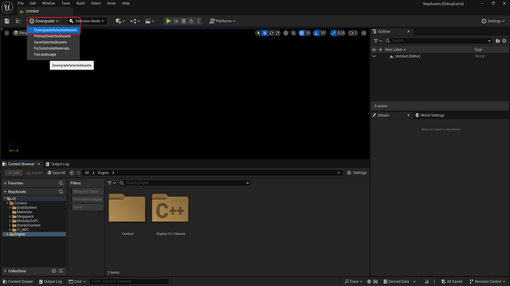
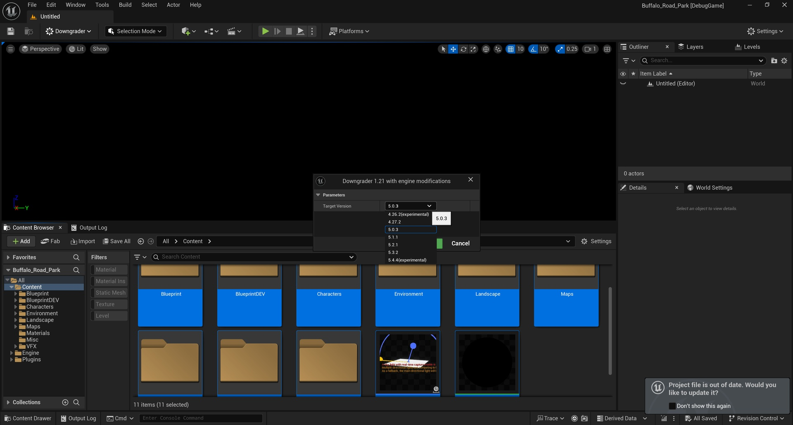
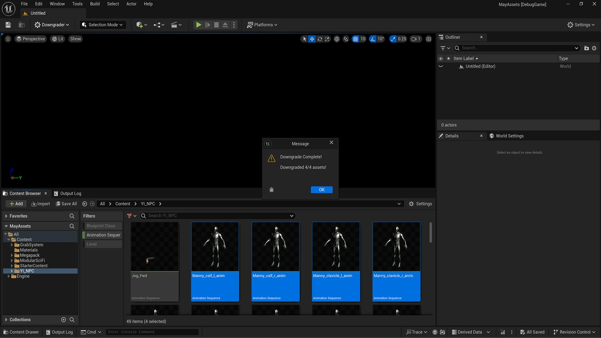

# 从虚幻引擎 5 迁移

使用 [UE Downgrader](../Plugins/Proposed-Plugins.md) 插件把资源降级，它支持 UE 5.8 及更低版本，一直能回到 UE4。代码迁移比在原生 UE4 上更容易，因为 Vite 向后移植了许多 UE5 容器、游戏框架与 GAS API。UE4 里不存在的功能（Nanite、Lumen、VSM、World Partition）没有对应项，需要做设计决策，而不是靠转换。

将项目从虚幻引擎 5 迁移到 Vite 是真正的迁移，而不是版本升级。本页列出了哪些内容可以干净地迁移，哪些内容需要替换，以及按什么顺序进行。

## 什么迁移了，什么没有迁移

| UE5 特性 | Vite 中的状态 | 该怎么办 |
|---|----------------|---|
| 静态网格体、纹理、材质、动画 | 可迁移 | 用 UE Downgrader 插件降级 |
| 蓝图 | 可迁移 | 降级后逐个节点复测；部分 UE5 专属节点没有对应目标 |
| C++ 游戏代码 | 可迁移 | Vite 向后移植了许多 UE5 API；见下文 |
| 游戏能力系统 | 可迁移 | Vite 包含从 UE5 向后移植的 GAS 更新 |
| Nanite | 无对应项 | 改用常规 LOD；表面细节用[曲面细分](../Rendering/Tessellation.md) |
| Lumen | 需替换 | 改用 [DDGI](../Rendering/DDGI-Dynamic.md)，可选配合 [SSGI](../Rendering/SSGI.md) |
| 虚拟阴影贴图 | 无对应项 | 改用级联阴影贴图，或[光线追踪阴影](../Rendering/RT-Shadows-And-Ambient-Occlusion.md) |
| TSR | 需替换 | [DLSS、FSR、XeSS](../Rendering/Upscalers.md)，或用 [SMAA](../Rendering/Anti-Aliasing.md) 走原生渲染 |
| MegaLights | 需替换 | [RTXDI](../Rendering/RTXDI.md) |
| Chaos 物理 | 需替换 | [PhysX](../Physics/PhysX.md) |
| Chaos Destruction | 需替换 | [Apex Destruction](../Physics/Destruction-And-Cloth.md) 与 [Blast](../Physics/Destruction-And-Cloth.md) |
| Chaos Cloth | 需替换 | [Apex Cloth](../Physics/Destruction-And-Cloth.md) |
| Substrate | 无对应项 | 标准材质模型，加上 [Callisto BRDF](../Rendering/Shading-Models.md) |
| 世界分区 | 需替换 | World Composition 与关卡流送 |
| Niagara | 可迁移 | 可用；[PopcornFX](../Plugins/Proposed-Plugins.md) 是更快的替代方案 |
| MetaSounds | 无对应项 | 声音提示（Sound Cues），或 [Wwise](../Plugins/Proposed-Plugins.md) |

## 资源降级

UE Downgrader 插件可把 UE 5.8 及更低版本的资源转换回 4.27 与 4.26。它的做法是先把资源升到其源版本（通常是最新的 UE5），再对 `.uasset` 文件打补丁，让目标版本能够读取，同时剔除旧格式无法表示的数据。例如 Nanite 数据会在降到 4.27 时被去掉。

插件做不到的是给 4.27 里不存在的功能凭空造出对应项。Nanite、遮罩材质、新材质节点和新 Niagara 模块上的内容，迁移后都无法保留；要为重做这些内容预留明确预算。

该插件为商业插件。作者 Ciprian Stanciu 活跃于 [Vite Discord](https://discord.gg/n9zQrYFhMb)，并为多个 Vite 项目提供直接支持。另有工作流程的[视频演示](https://youtu.be/yXvJfDNfrSQ)。

## 迁移代码

这部分在 Vite 上比原生 4.27 容易。该分支刻意向后移植 UE5 的 API 面，让 UE5 时代的代码只需较少改动即可编译：更新的容器类、游戏框架更新和游戏能力系统功能都已具备。

你仍然会遇到分歧。按以下顺序完成它们：

1. **物理。** 任何涉及 `Chaos` 命名空间、`FChaosScene`、几何集合（Geometry Collection）或 Chaos 车辆的内容，都需要迁到 PhysX 的对应实现。这通常是单项最大的工作量。参见 [PhysX 概述](../Physics/PhysX.md)。
2. **渲染。** 查询或驱动 Lumen、Nanite、VSM 控制台变量的代码没有对应目标，请替换为[渲染](../Rendering/Rendering.md)中 Vite 的等效项。
3. **核心 API 差异。** `FVector` 在 UE5（`FVector3d`）中是双精度，在 4.27 中是单精度，大世界坐标的假设不再成立。要审查所有在大世界偏移下做精度敏感运算的代码。
4. **模块与构建规则。** 引用了 UE5 专属模块的 `.build.cs` 文件，需要删掉或替换这些依赖。

## 推荐的迁移顺序

### 将 UE5 项目迁移到 Vite

1. 首先创建一个空的 Vite 项目，并确认你的工具链和引擎构建正常。不要同时调试两个问题。

2. 移植不包含任何内容的 C++ 模块。在迁移任何资源之前，确保它们能够针对 Vite 进行编译。在此处检查物理和渲染 API 是否存在兼容性问题。

3. 降级并导入一个有代表性的小型内容切片——一个角色、一个场景和少量材质，确认外观与行为正确。

4. 替换光照设置。Lumen 没有直接对应物；设置 [DDGI](../Rendering/DDGI-Dynamic.md) 体积，再根据刚导入的切片调整。

5. 重建物理设置。使用 [Apex Destruction](../Physics/Destruction-And-Cloth.md) 重新制作物体破坏效果，使用 [Apex Cloth](../Physics/Destruction-And-Cloth.md) 重新制作布料效果。

6. 验证内容片段后，批量迁移剩余内容。

7. 针对目标硬件进行性能分析并设置可扩展性。请参阅[性能分析和基准测试](../Performance/Profiling.md)。

## 混合版本工作流程

不必一夜之间让所有人迁过来。一种常见安排是：程序员在 Vite 里工作，美术与内容创作者继续用 Epic Games Launcher 装的原生 4.27，内容单向流动。为此，启动器端的用户需要独立的 [DDGI 1.1.5 插件](https://github.com/GapingPixel/UE4-RTXGI-1.1.5-Latest-Official)，让光照看起来大致正确。Vite Studio 就是这么做的，到目前为止建模、动画与声音设计都没有出问题。

!!! warning
    不要在 Vite 项目里使用启动器的 DDGI 插件。Vite 已把 DDGI 作为引擎的一部分提供，两者会冲突。Vite 内的 DDGI 也比 Launcher 版插件处理得更好，因为引擎端与 DDGI 插件端都有改动。

## 另请参阅

- [Vite 简介](Introduction-to-Vite.md)
- [PhysX 概述](../Physics/PhysX.md)
- [全局光照](../Rendering/Global-Illumination.md)
- [建议的插件](../Plugins/Proposed-Plugins.md)
- [UE4 与 UE5 成本分析](../EngineOverview/UE4-Versus-UE5-Cost-Analysis.md)
