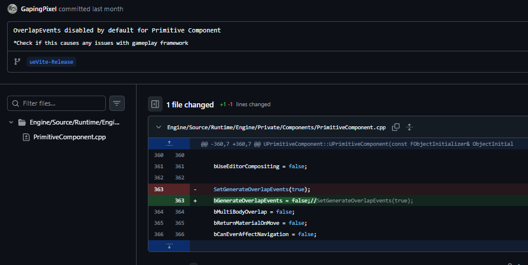
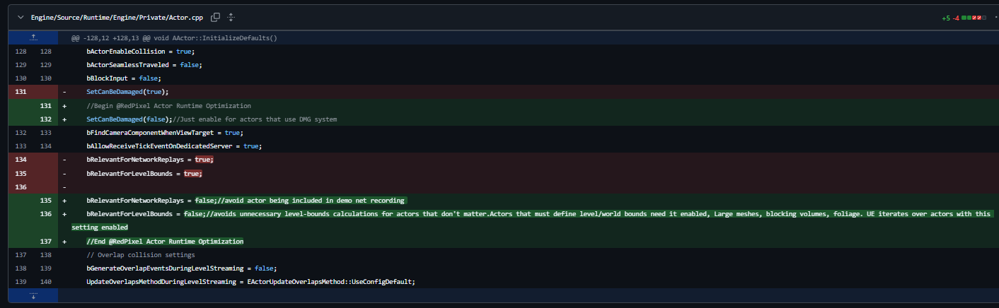
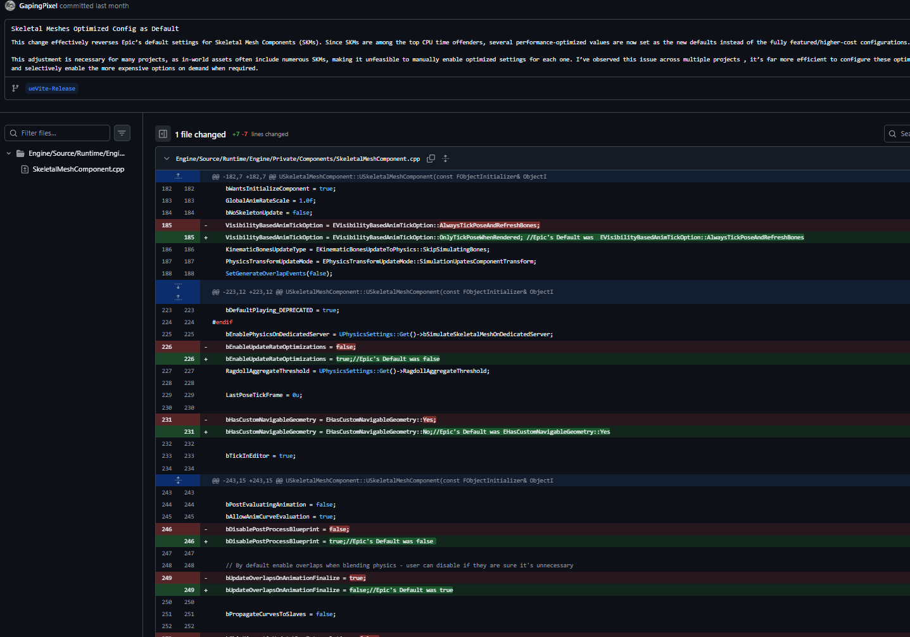
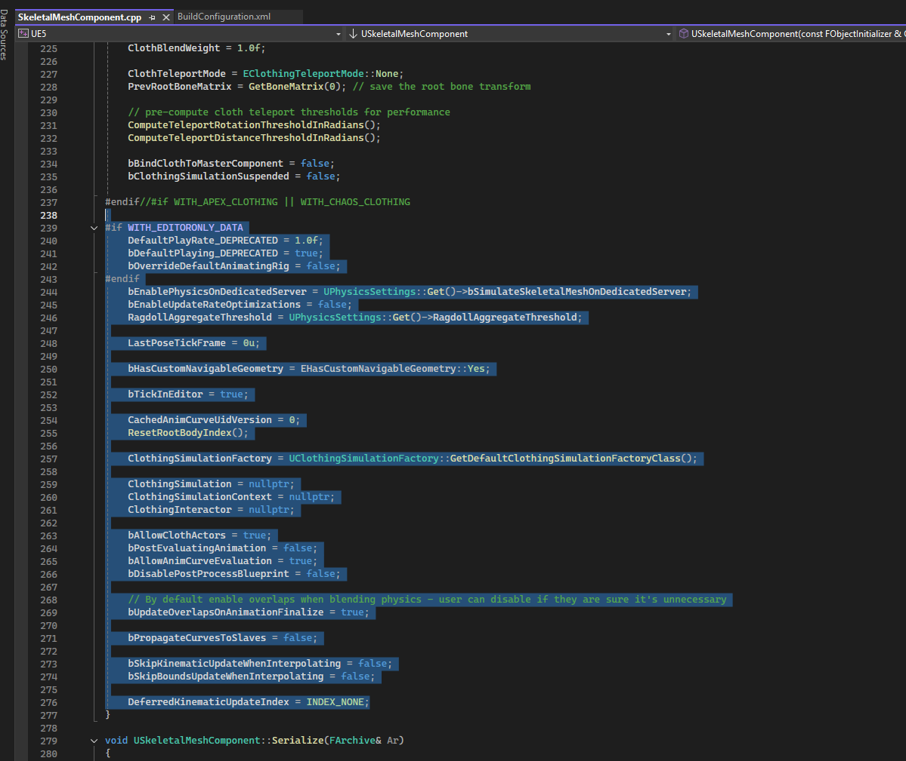

# 引擎默认更改

为了提升性能，Vite 修改了虚幻引擎 4.27 的一些默认设置。这些修改会直接影响您的项目——其中一些会改变运行时行为，而不仅仅是成本。在断定项目出现问题之前，请先阅读此页面。

虚幻引擎的默认设置旨在确保所有功能开箱即用，这意味着它们启用了大多数项目永远不会用到的功能。Vite 修改了其中一些设置以提升性能，其原则是：您需要的功能应该是您主动开启的，而不是您忘记关闭的。

但代价是，从虚幻引擎 4.27 迁移到 Vite 的项目可能会出现不同的行为。此页面列出了所有变更。

## 运行时行为变更

**警告：** 这些更改不仅会改变性能，还会改变行为。如果游戏逻辑依赖于默认设置，则需要进行调整。

### 默认情况下禁用重叠事件 <span id='disabled_overlap'></span>

除非显式启用，否则基本组件不再生成重叠事件。

生成重叠事件会消耗所有组件的资源，无论是否有任何组件绑定到该事件。在默认项目中，大多数基本组件生成的重叠事件都没有被任何组件监听。

**这意味着**：需要重叠事件的组件必须显式设置**生成重叠事件**。触发器体积、拾取检测以及任何由 `OnComponentBeginOverlap` 驱动的组件都需要设置此标志。这很可能是项目迁移后“我的触发器停止工作”问题的原因。



*[提交差异](https://github.com/GapingPixel/UE5-PhysX-Vite/commit/02d7c0ad0a7542b382a70dc3e37877d6ec052d76)：将 PrimitiveComponent.cpp 中的 SetGenerateOverlapEvents(true) 替换为 bGenerateOverlapEvents = false，应用于每个项目中的每个基本组件。*


### 优化 Actor 运行时

Actor 运行时默认值已更改，以减少 `AActor::InitializeDefaults` 中每个 Actor 的开销：

| 默认 | 库存的 4.27 | Vite | 原因 |
|---|---|---|---|
| `SetCanBeDamaged` | `true` | `false` | 仅使用伤害系统的参与者需要此设置 |
| `bRelevantForNetworkReplays` | `true` | `false` | 除非需要，否则将参与者排除在演示网络录制之外 |
| `bRelevantForLevelBounds` | `true` | `false` | 避免对未定义边界的参与者进行边界迭代 |



*[提交 Actor.cpp 中的差异](https://github.com/GapingPixel/UE5-PhysX-Vite/commit/970cbb989c3712f13be1fa370b778e769e5d864c)：更改 SetCanBeDamaged、bRelevantForNetworkReplays 和 bRelevantForLevelBounds 的默认值。大型网格、阻挡体积和必须定义世界边界的植被需要将 `bRelevantForLevelBounds` 设置为 `true`。*

### 骨骼网格体优化配置

骨骼网格体是大多数项目中 CPU 占用率最高的组件之一，因此 `USkeletalMeshComponent` 默认提供的是性能优化配置，而非 Epic 提供的完整功能配置。游戏内资源通常包含大量骨骼网格体，因此为每个组件启用优化设置并不实际；可行的做法是将性能较低的配置设为默认，并在需要时启用性能较高的配置。

| 默认 | 库存的 4.27 | Vite |
|---|---|---|
| `VisibilityBasedAnimTickOption` | `AlwaysTickPoseAndRefreshBones` | `OnlyTickPoseWhenRendered` |
| `bEnableUpdateRateOptimizations` | `false` | `true` |
| `bHasCustomNavigableGeometry` | `Yes` | `No` |
| `bDisablePostProcessBlueprint` | `false` | `true` |
| `bUpdateOverlapsOnAnimationFinalize` | `true` | `false` |



*SkeletalMeshComponent.cpp 中的[提交差异](https://github.com/GapingPixel/UE5-PhysX-Vite/commit/33fe7c638829b8120e8a02ecc639acda761df835)显示了与 Epic 原版相比的五个已更改的默认值。每行更改的内容都会在末尾的注释中保留 Epic 的原始值，因此无需咨询上游即可恢复库存行为。*

`VisibilityBasedAnimTickOption` 是需要关注的选项。`OnlyTickPoseWhenRendered` 表示屏幕外的参与者将完全停止评估其姿势；读取未渲染参与者骨骼变换或插槽的游戏玩法（例如武器枪口位置、IK 目标、远处参与者上的连接点）必须将组件设置回 `AlwaysTickPose` 或 `AlwaysTickPoseAndRefreshBones`。

`bDisablePostProcessBlueprint = true` 是第二个选项：后处理动画蓝图（通常用于 IK 和骨骼校正）将不再运行，除非为每个组件重新启用。



*SkeletalMeshComponent.cpp 构造函数显示了周围的默认块。有关这些默认值设置位置的上下文，请参阅 `SkeletalMeshComponent.cpp` 中的构造函数块。*


### 已禁用生成光照贴图 UV

默认情况下，静态网格体导入不再生成光照贴图 UV（[提交差异](https://github.com/GapingPixel/UE5-PhysX-Vite/commit/acce6fbe432fe9fe5a2536f0979befd5dcd741d1)）。

大多数 Vite 项目使用 [DDGI](../Rendering/DDGI-Dynamic.md) 而非烘焙光照，因此为每个导入的网格体生成光照贴图 UV 会浪费导入时间和 UV 通道。如果您的项目使用烘焙光照，请在静态网格体导入选项中启用此设置。


## 可扩展性

Vite 重新平衡了 `Engine/Config/BaseScalability.ini` 里的阴影可扩展性分组。原生 4.27 从 Low 几乎没有阴影，一路铺到 Epic 与 Cinematic 非常昂贵；Vite 把这个跨度收窄了：Low 有可用的阴影，High 与 Epic 更便宜，Medium 保持不变。

| 分组 | `r.ShadowQuality`（原生 → Vite） | 相对原生的其他变化 |
|---|---|---|
| Low（`@0`） | 0 → **2** | 四个级联而不是一个，最大阴影分辨率 1024，距离场与胶囊体阴影开启，光照函数开启，光源保留完整绘制距离 |
| Medium（`@1`） | 3 → 3 | 无 |
| High（`@2`） | 5 → **4** | 阴影距离缩放 0.85 → 0.75，级联过渡 0.8 → 0.7 |
| Epic（`@3`） | 5 → 5 | 最多 8 个级联而不是 10 个，半径阈值 0.01 → 0.02，距离缩放 1.0 → 0.85，体积雾网格 16 px × 64 层而不是 8 px × 128 |
| Cinematic | 5 → 5 | 最大阴影分辨率 4096 → 2048，体积雾网格 8 px 而不是 4 px，历史未命中的超采样 4 次而不是 16 |

如果项目靠原生的 Epic 或 Cinematic 阴影预算来出预告片或离线截图，请在项目的 `DefaultScalability.ini` 里覆盖这些值，而不是改引擎文件。

## 切换回原生游戏默认值

上面这些重叠与骨骼网格体默认值最容易弄坏迁移过来的项目。自 8 月主要版本起，引擎根目录的 `ViteDefaults.bat` 可以在 Vite 与原生 UE 4.27 之间切换这些默认值，不用手改引擎源码：

```
ViteDefaults.bat                                  :: interactive menu showing the current state
ViteDefaults.bat -DetectOnly                      :: report the current state only
ViteDefaults.bat -SetOverlap ue427 -SetSkm vite   :: stock overlap, Vite skeletal mesh defaults
```

它会改写 `PrimitiveComponent.cpp` 与 `SkeletalMeshComponent.cpp`，所以之后要重新编译编辑器。能改项目里的组件就优先改项目；把引擎默认值切回去，等于把开销重新摊到每个关卡的每个图元或骨骼网格体上。

## 已禁用的插件

Vite 的插件配置会关掉大多数 Win64 项目从不加载的引擎插件，从而缩短编辑器启动时间、减少模块加载数量、减小打包体积。这份配置如何落到你的代码树，取决于版本：

| 版本 | 配置的应用方式 |
|---|---|
| LTS 至 6 月主要版本 | 直接内置在源码树里：插件以 `EnabledByDefault = false` 随附 |
| 7 月主要版本起 | 源码树保留原生 4.27 的值以维持兼容。运行 `devops\ueVite-ApplyVitePluginDefaults.bat` 应用配置 |

配置清单在 `devops\ViteEnginePluginDefaults.txt`，关掉 39 个引擎插件，打开 1 个：

- **关闭：** Paper2D；CLion、CodeLite 与 KDevelop 源码访问器；Plastic SCM 与 Subversion 源码管理；Chaos Cloth、Chaos Editor、Chaos Niagara 与 Chaos 求解器插件；Alembic 导入器；Facial Animation；Crypto Keys；Android、Apple 与 WMF 媒体播放；OpenXR、Oculus VR 与 SteamVR；以及 Google Cloud Messaging、Google PAD、Chunk Downloader、Mobile Patching Utils 等移动服务。
- **开启：** Blast，也就是 Vite 的[破碎](../Physics/Destruction-And-Cloth.md)路径。

```
devops\ueVite-ApplyVitePluginDefaults.bat            :: apply the Vite profile
devops\ueVite-ApplyVitePluginDefaults.bat --dryrun   :: report what would change
devops\ueVite-ApplyVitePluginDefaults.bat --stock    :: restore the stock 4.27 values
```

`--yes` 跳过确认提示。脚本只改 `.uplugin` 文件，因此在 `.uproject` 里显式点名某个插件的项目不受影响。

**VR 插件要单独注意**，需要就必须重新打开；Windows 上通过 Media Framework 播视频的项目，WMF Media 也一样。

[提交 1](https://github.com/GapingPixel/UnrealEngineVite-PhysX/commit/e9aebc2ef9f8acb7326a7e989f288ef68969342f) &middot;
[提交 2](https://github.com/GapingPixel/UnrealEngineVite-PhysX/commit/6c5948bf12ea61f82784193ccaa5d43c4f574ae9)

## 可以关掉的 Tick

### Niagara

插件启用时 Niagara 就会 Tick。不用就在项目级别关掉 Niagara 插件；4.27 里 Cascade 仍然可用。

## 光线追踪效果默认关闭

原生 4.27 让后期处理体积决定光追反射、半透明与环境光遮蔽是否运行（`-1`），并把光追阴影打开（`1`）。从 LTS 起的每个 Vite 版本都把四项设为 `0`：

| CVar | 原生 4.27 | Vite |
|---|---|---|
| `r.RayTracing.Reflections` | `-1`（后期处理体积决定） | `0` |
| `r.RayTracing.Translucency` | `-1`（后期处理体积决定） | `0` |
| `r.RayTracing.AmbientOcclusion` | `-1`（后期处理体积决定） | `0` |
| `r.RayTracing.Shadows` | `1` | `0` |

值为 `0` 时，这些效果的后期处理体积设置会被忽略；在体积里开过它们的项目，迁到 Vite 后一个都跑不起来。把 CVar 设为 `-1` 恢复原生行为，设为 `1` 则强制开启：

```ini
; Config/DefaultEngine.ini
[/Script/Engine.RendererSettings]
r.RayTracing.Reflections=-1
r.RayTracing.AmbientOcclusion=-1
```

光追半透明默认也被 `VITE_RT_PSO_DEBLOAT` 编译移除了，所以它的 CVar 只在关掉这个开关的构建里才有意义。它的帮助文本仍把 `-1` 写成默认值，代码里其实是 `0`。

## 光线追踪剔除：未改动，但值得开启

Vite 在这里保留原生 4.27 的行为：`r.RayTracing.Culling` 默认 `0`，因此不管光追图元在相机哪个方位，都留在加速结构里。在大场景里，打开它是最便宜的光追优化之一：

```ini
; Config/DefaultEngine.ini
[SystemSettings]
r.RayTracing.Culling=1
r.RayTracing.Culling.Radius=10000
r.RayTracing.Culling.Angle=1
```

开启后，**相机后方**的物体如果距离超过 `r.RayTracing.Culling.Radius`（默认 10000，即 100 m），或投影角度小于 `r.RayTracing.Culling.Angle`，就会被剔除。相机前方的物体永远不会被剔除，所以直接可见的画面不变，但被剔除的物体会从反射与光追阴影里消失。开启后记得检查玩家身后的镜面与大型投影物。

!!! note
    UE5 的 `r.RayTracing.Culling.UseMinDrawDistance` 在 4.27 与 Vite 中都不存在。

## 编辑器默认值

这些不影响运行时性能，但会改变编辑器行为，设置在 `Engine/Config/BaseEditorSettings.ini` 与 `BaseEditorPerProjectUserSettings.ini`：

| 设置 | Vite 默认值 | 作用 |
|---|---|---|
| `bDisableAllTutorialAlerts` | `True` | 编辑器里不弹教学提示 |
| `bShowNewPluginsPopup` | `True` | 设为 `False` 可关掉「有新插件可用」弹窗 |
| `bSendUsageData`、`bSendUnattendedBugReports` | `False` | 编辑器不上报使用数据，也不发送无人值守崩溃报告 |
| `bEnableAsyncTextureCompilation` | `True` | 纹理在后台编译，不阻塞编辑器 |
| `bCopyStarterContentPreference` | `False` | 新项目不附带 Starter Content |
| `bGenerateLightmapUVs` | `False` | 见[默认不生成光照贴图 UV](#默认不生成光照贴图-uv) |

编辑器的新闻推送也被移除，动画资源始终在新标签页打开——这是从 UE5 移植过来的行为（[提交](https://github.com/GapingPixel/UnrealEngineVite-PhysX/commit/8bdae919e6eae61a27ef8d09d38027592a473d8c)）。

## 可以自行选择的精简

这些出于兼容性考虑没法在分支发布版里关掉，但单个项目可以用。

**移除 Vite 插件。** 移除新增的 Vite 插件能缩短编译时间。在 Ryzen 9 9950X3D 上、Houdini Engine 还随附时测得：完整仓库 15 分钟，去掉 Vite 插件 12 分钟，Houdini 是最大的单一贡献项。6 月主要版本移除了 Houdini，所以现在的差距更小。

工具见[精简指南](Debloat-Guide.md)。

## 迁移现有项目

1. 测试每个触发体积和由重叠驱动的交互。重叠事件是最常见的故障点。
2. 检查使用 leader/follower 骨骼网格体配置的角色，曲线的传播是否还在。
3. 如果项目烘焙光照，重新打开光照贴图 UV 生成，并确认已有网格体的光照贴图 UV 仍然有效。
4. 重新启用项目需要的插件，尤其是 VR 与 WMF Media。
5. 复查可扩展性设置，因为 Low、High、Epic、Cinematic 的阴影现在都与原生不同。
6. 如果项目靠后期处理体积来开光追反射、半透明或 AO，把这些 CVar 设为 `-1`，见[光线追踪效果默认关闭](#光线追踪效果默认关闭)。

## 另请参阅

- [从 UE5 迁移](../GettingStarted/Migrating-From-UE5.md)
- [精简指南](Debloat-Guide.md)
- [性能分析](Profiling.md)
- [编译时切换](Compile-Time-Switches.md)