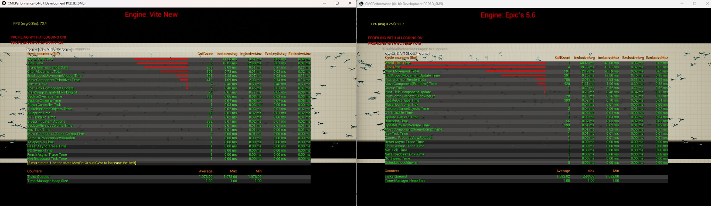
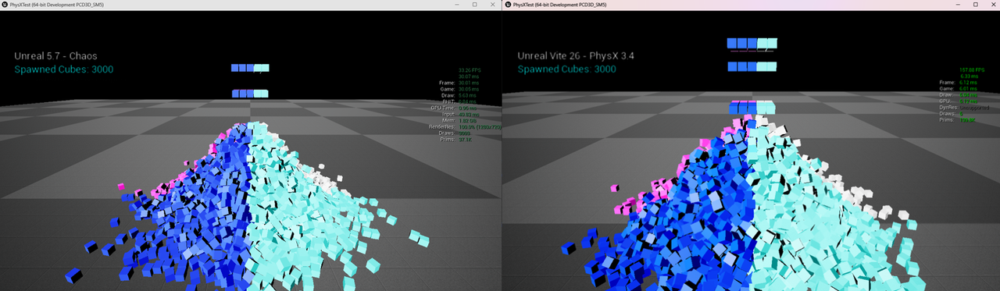

# 性能分析

!!! note "概要"
    先找瓶颈再优化。`stat unit` 会告诉你哪个线程在限制帧时间，后面的一切都从这个答案展开。

在对场景进行优化之前，请先找到性能瓶颈。`stat unit` 命令可以告诉你哪个线程限制了帧数；后面的一切优化操作都由此展开。


虚幻引擎 4.27 的性能分析工具已经非常成熟，文档也齐全。本页讲如何在 Vite 的[性能目标](../EngineOverview/Performance-Targets.md)下使用它们，以及 Vite 特有的、值得盯住的地方。


## 首先使用 `stat unit` 命令

```
stat unit
```

这是每个分析会话中的第一个命令。它报告：

| 行 | 含义 |
|---|---|
| **Frame** | 总帧时间。这是您的实际帧速率。 |
| **Game** | 游戏线程：gameplay、Tick、物理、动画 |
| **Draw** | 渲染线程：构建绘制命令、RHI 提交 |
| **GPU** | GPU时间 |
| **RHIT** | RHI 线程（如果存在） |

Game、Draw 和 GPU 中最大的那个就是你的瓶颈。帧时间大致等于它，因为线程是并行运行的，最慢的线程会影响其他线程的运行。

这一读数决定了后续的一切。如果优化的线程不是瓶颈线程，帧率就不会有任何提升，这是虚幻引擎性能优化中最常见的浪费。

### 找出瓶颈

1. 在接近最终发布版本的构建配置中，于典型场景运行 `stat unit`。

2. 注意 Game、Draw 和 GPU 中哪个最接近 Frame。

3. 用 `r.ScreenPercentage 50` 确认。帧时间明显下降，说明瓶颈在 GPU 的像素开销上；几乎不变，则不是。开着 FSR、DLSS 或 XeSS 时改用 `r.Upscaler.ScreenPercentageOverride 50`——这些插件会忽略 `r.ScreenPercentage`。

4. 请参阅下面的相关内容。


## 游戏线程瓶颈

游戏线程是 UE4 时代引擎最常出现瓶颈的地方，也是 Vite 相对 UE5 继承优势最大的地方。

```
stat game        // 顶层游戏线程细分
stat physics     // 物理模拟成本
stat anim        // 动画与骨骼网格体求值
stat engine      // Tick 计数与一般引擎统计
stat slate       // UI 成本
```

### 常见开销

**Actor 的 Tick 数量。** 每个开启 Tick 的 Actor 都要花成本，哪怕它的 Tick 什么都不做。`stat engine` 会报告 Tick 数量。不需要的 Actor 就关掉 Tick；确实要跑的逻辑，用 Tick 间隔，而不是在 `Tick` 里提前 return。

**角色移动：** 角色移动组件（Character Movement Component, CMC）开销很大，并且会随着角色数量的增加而急剧增加。[400 角色 CMC 基准测试](../ProjectsAndDemos/400-Characters-CMC-Bench.md)演示程序正是为了精确地衡量这一点而存在的。如果你有很多角色，这很可能就是你的主要开销。



**物理引擎。** 另请参阅[PhysX](../Physics/PhysX.md)。看物理耗时占游戏线程时间的比例。大量模拟刚体应当迁到[实例化物理子系统](../Physics/Instanced-Physics.md)。

**重叠事件。** Vite 默认禁用图元组件的重叠事件，正是因为它们是常见的隐藏开销。另请参阅[引擎默认设置更改](../Performance/Engine-Defaults.md)。

**蓝图。** 蓝图虚拟机的执行速度比原生 C++ 慢。每帧的热点逻辑应该用 C++ 编写。

## 渲染线程瓶颈

```
stat scenerendering    // 渲染线程细分
stat initviews         // 可见性和剔除成本
stat rhi               // 绘制调用、图元、三角形
```

渲染线程开销主要取决于绘制调用次数和可见性计算。

**绘制调用次数：** `stat rhi` 命令会报告绘制调用次数。可以通过实例化、网格合并以及减少每个网格的材质槽位来降低绘制调用次数。注意 Vite 没有 Nanite，因此绘制调用纪律比 UE5 更为重要。

**可见性：** `stat initviews` 命令会显示剔除开销​​。过高的图元数量会使剔除本身开销巨大。预计算可见性和遮挡剔除会有所帮助；减少图元数量也能起到同样的作用。

## GPU 瓶颈

```
stat gpu               // GPU 通道细分
profilegpu             // 详细的单帧 GPU 捕获
r.ScreenPercentage 50  // 像素成本界限的 A/B 测试
```

`profilegpu` 是最重要的工具。它会生成单帧渲染的每个通道的详细分析，从而告诉你 GPU 时间都用在了基础渲染、阴影渲染、光线追踪、后期处理还是其他意外情况上。

对 Vite 项目来说，值得盯住的通道：

| 渲染通道 | 说明 |
|---|---|
| 光线追踪通道 | 请参阅[光线追踪](../Rendering/Ray-Tracing.md)。`r.RayTracing.ForceAllRayTracingEffects 0` 设置它们在帧中所占的比例。 |
| DDGI | 应该是温和、稳定的。另请参阅[动态DDGI](../Rendering/DDGI-Dynamic.md)。 |
| 底通道 | 由材质复杂度与重叠绘制驱动 |
| 阴影深度 | 由阴影投射光数和级联配置驱动 |
| 半透明 | 由重叠绘制驱动。粒子通常是主因。 |
| SMAA | 开销小而固定。如果异常大，检查 `r.SMAA.Quality`。 |

## 查看模式

视口视图模式通常比抓一次 profile 更快定位问题：

| 视图模式 | 揭示的问题 |
|---|---|
| Shader Complexity | 昂贵的材质与重叠绘制 |
| Quad Overdraw | 小三角形浪费 quad 占用 |
| Light Complexity | 重叠的动态灯光 |
| Lightmap Density | 光照贴图分辨率问题 |
| Wireframe | 失控的[曲面细分](../Rendering/Tessellation.md)与意外的几何密度 |


## 会话前端

**窗口 > 开发者工具 > 会话前端 > Profiler**会捕获一个可拖动的时间线，这是处理间歇性卡顿的理想工具。每 30 秒发生一次的卡顿不会显示在`stat unit`中。

Vite 项目里常见的卡顿来源：

- 首次遇到材质时着色器编译。请参阅[着色器编译和 PSO](Shader-Compilation-And-PSO.md)。
- 大量几何体流送进来时，光追加速结构重建。
- 物理刚体创建高峰。请参阅[实例化物理](../Physics/Instanced-Physics.md)中的 `MaxAddActorsPerFrame`。
- 关卡流送与资源加载。
- 垃圾回收。

## 对照目标做性能分析

一个数字只有对着预算看才有意义。Vite 的[性能目标](../EngineOverview/Performance-Targets.md)给了你这份预算：

| 目标 | 帧预算 |
|---|---|
| 风格化 4K120 | 8.3&nbsp;ms |
| 性能 高端 4K60 | 16.6&nbsp;ms |
| 保真 高端 4K30 | 33.3&nbsp;ms |
| 保真 全 RT 1440p30 | 33.3&nbsp;ms |


*模拟 3000 个立方体：虚幻引擎 5.7 搭配 Chaos 为 33.26 FPS，Vite 搭配 PhysX 3.4 为 157.88 FPS。*

在符合最低配置要求的硬件上，使用开发或测试版本（而非编辑器）进行性能分析，并选择能够代表最坏情况的游戏场景（而非空关卡）。仅编辑器开销就可能达到几毫秒，而空关卡中的性能分析无法反映最终交付的帧性能。


## 另请参阅

- [性能目标](../EngineOverview/Performance-Targets.md)
- [UE4 与 UE5 成本分析](../EngineOverview/UE4-Versus-UE5-Cost-Analysis.md)
- [引擎默认设置变更](./Engine-Defaults.md)
- [着色器编译和 PSO](./Shader-Compilation-And-PSO.md)

