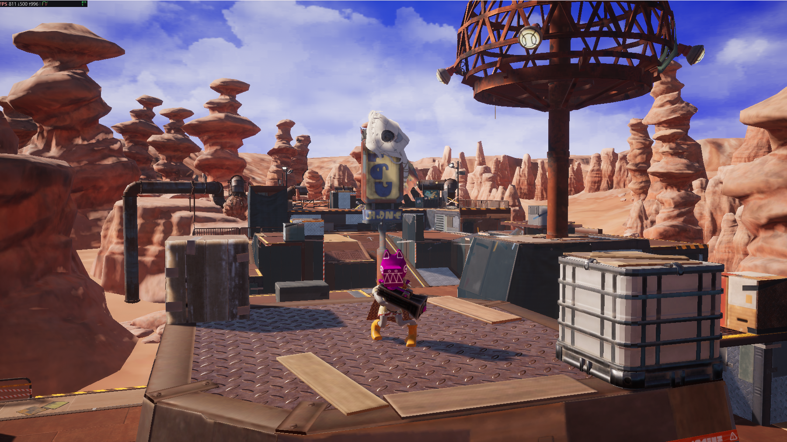
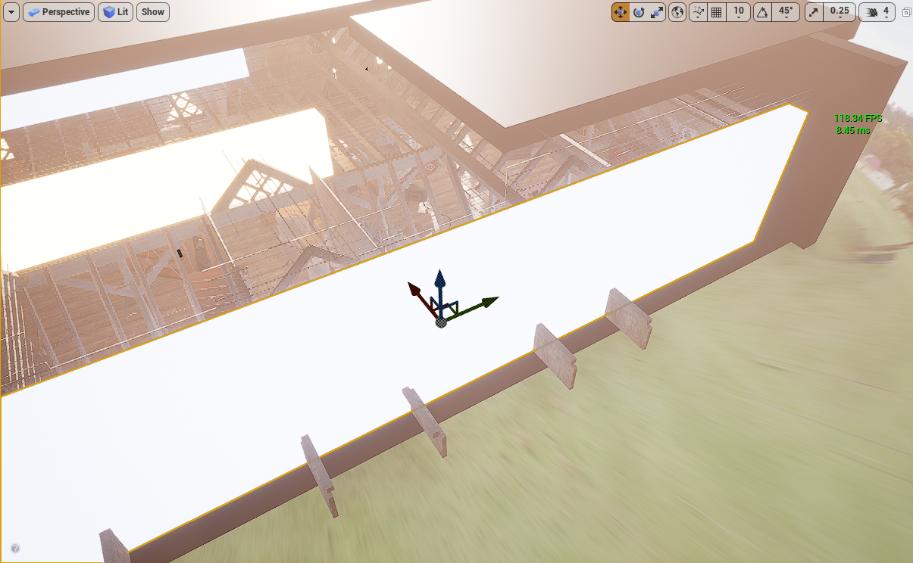

# 全局光照

Vite 推荐的 GI 组合是**动态 DDGI 加 SSGI**。DDGI 无噪声地解析世界尺度的弹射；SSGI 补上探针体积太粗、抓不到的高频接触细节。DDGI 默认开启（`r.GlobalIllumination.ExperimentalPlugin 1`），再叠加 `r.SSGI.Enable 1` 即可。


全局光照是 Vite 作为独立分支存在的最大原因。本页解释了这些选项以及如何在它们之间进行选择；各个技术都有自己的页面。

## 选项

| 解决方案                          | 成本                 | 需要 DXR | 动态照明 | 最适合                                                          |
|-----------------------------------|----------------------|---|---|-------------------------------------------------------------------|
| [动态 DDGI](./DDGI-Dynamic.md)   | 低                  | 是 | 完全动态 | 几乎所有的东西                                                 |
| [静态 DDGI](./DDGI-Static.md)     | 运行时接近于零 | 否 | 烘焙 | 低端和无 DXR 硬件                                       |
| [SSGI](./SSGI.md)                   | 低                  | 否 | 完全动态 | 高频细节，与 DDGI 一起运行                 |
| [Per-pixel RT GI](./Ray-Tracing.md) | 高                 | 是 | 完全动态 | GPU 比 PS5 快得多，参考                     |
| [路径追踪](./Path-Tracing.md)                      | 极高                | 是 | 完全动态 | RTX 5080 及以上，真值参考                        |
| 烘焙光照贴图                   | 运行时为零      | 否 | 仅静态 | 全静态场景，使用 CPU Lightmass 以获得最高质量 |


!!! note "注意"
    Vite 还包括若干次级间接弹射方案，例如距离场弹射和 Vite 特有的局部 IBL 捕获。除了非常具体的目标平台或专门的设置之外，它们很少被选中来替代上面这些方案。


## 为什么选择 DDGI 而不是 Lumen

动态漫反射全局光照将辐照度存储在探针网格中，并用球谐函数过滤。由于表示在构造上就是平滑的，结果无需降噪器即为无噪，这是它相对 Lumen 大部分优势的根源。

与软件 Lumen 相比，DDGI 的弹射质量更高、漏光更少。与硬件 Lumen 相比，弹射质量相当，但通常大约快一倍——这里比的是整场景帧率，而不是单看 GI 成本。在 RTX 4080 Super 上以 1440p 原生运行的一个代表性测试场景中，DDGI 测得 811 FPS，Lumen 5.7 为 324 FPS。AMD 硬件上这套技术同样站得住：同类测试场景在 RX 6600 上以 1080p 原生跑到 245 FPS。


DDGI 也不是实验性技术。[《地铁：离去》增强版](https://wccftech.com/metro-exodus-enhanced-edition-impressions-4a-games-delivers-the-most-advanced-lighting-yet-without-sacrificing-performance/amp/)把多弹射 GI 建立在它之上；[《巫师 3》次世代更新](https://www.nvidia.com/en-gb/geforce/news/witcher-3-wild-hunt-dlss-rtx-ray-tracing-free-update-out-now/)在 PC 上使用 NVIDIA 的 RTXGI 实现，[《总决赛》](https://www.nvidia.com/en-gb/geforce/news/the-finals-geforce-game-ready-driver/)则在所有平台使用；[《守望先锋 2》](https://enginearchitecture.org/downloads/REAC_2025_Overwatch.pdf)正在把地图从 Enlighten 迁移到基于 DDGI 的方案。这套技术在设计上就要覆盖很宽的硬件范围，从适合静态模式的 Xbox One S GPU，到适合动态 RT 模式的 GTX 1060 级 GPU。



*811 FPS，RTX 4080 Super，1440p 原生，动态 DDGI。同一场景在 Lumen 5.7 下测得 324 FPS。*



*阁楼旁放置的一个大面积自发光平面（已选中）。自发光材质会直接贡献给 DDGI，因此不放置灯光 Actor 也能用自发光几何体照亮场景。*

## 为什么将 DDGI 与 SSGI 配对

探针体积有空间分辨率。小于探针间距的细节——椅子腿与地板相接处的变暗、狭窄缝隙里的弹射、桌子下方的接触阴影——不会被表示出来，因为那里没有探针。


屏幕空间 GI 以像素分辨率运行，恰好能捕捉这些细节。两种技术的短板正好相反：SSGI 对屏幕外或被遮挡的东西一无所知，而 DDGI 在粗分辨率下掌握完整的世界信息。两者一起跑，DDGI 提供世界尺度的弹射，SSGI 提供高频接触细节。这是 NVIDIA 在 Unreal Engine DDGI 演示中官方推荐的组合，Vite 的 SSGI 开箱即配置为与 DDGI 协同工作。

这在 UE5 里做不到。SSGI 并入 Lumen 之后质量和性能都退化了，也无法再与独立的 GI 方案同时启用。在 Vite 里它仍是 UE4 时代的实现，可以干净地组合。

## 启用推荐设置

```c++
IConsoleManager::Get().FindConsoleVariable(TEXT("r.GlobalIllumination.ExperimentalPlugin"))->Set(1);
IConsoleManager::Get().FindConsoleVariable(TEXT("r.SSGI.Enable"))->Set(1);
```

或者在配置中，这对于交付项目来说是更可取的，因为它参与了可扩展性：

```ini
; Config/DefaultEngine.ini
[/Script/Engine.RendererSettings]
r.GlobalIllumination.ExperimentalPlugin=1
r.SSGI.Enable=1
```

然后，您需要将 DDGI 体积放置在关卡中。请参阅 [动态 DDGI](./DDGI-Dynamic.md) 了解体积设置、探针密度和重要的设置。

## 根据硬件底线选择 GI 方案

### 选择 GI 配置

1. 如果您的最低配置支持 DXR，请使用动态 DDGI + SSGI。这是默认推荐配置，适用于 GTX 1060 6 GB 及以上显卡。

2. 如果您的最低配置完全不支持 DXR，请使用[静态 DDGI](./DDGI-Static.md)。它几乎可以瞬间完成烘焙，比传统的烘焙光照提供更好的弹射保真度，并且由于探针体积覆盖的是空间而非表面，因此能更好地处理移动物体。

3. 如果您需要同时支持这两种模式，请将静态 DDGI 作为可扩展性的备选方案。两种模式共享体积和制作流程，因此这是一种可扩展性设置，而不是对关卡进行第二次光照处理。

4. 只有在生成参考图像或预可视化时才使用逐像素光线追踪全局光照。它比 DDGI 的开销大得多，而且其优势无法弥补帧时间预算的限制。它还在默认构建中被编译掉，需要用 `VITE_RT_PSO_DEBLOAT=0` 重新构建——请参阅[编译时开关](../Performance/Compile-Time-Switches.md)。


## 另请参阅

- [动态 DDGI](./DDGI-Dynamic.md)
- [静态 DDGI](./DDGI-Static.md)
- [SSGI](./SSGI.md)
- [光线追踪](./Ray-Tracing.md)
- [性能目标](../EngineOverview/Performance-Targets.md)
